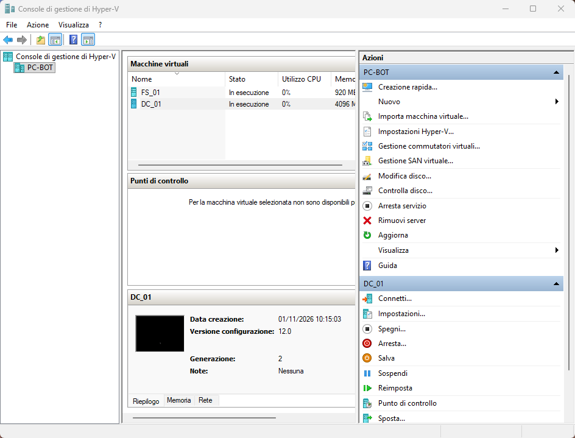

# Windows Server & Active Directory Lab

**Hands-on Windows infrastructure, system administration and troubleshooting.**

This repository documents my personal Windows Server and Active Directory laboratory, built using Hyper-V.

I have a professional background in IT support and computer networking, including specialized training in network design and previous experience as an independent IT consultant.

The purpose of this project is to refresh and expand my existing skills through practical configuration, administration, troubleshooting and security exercises.

**Project status:** Active and continuously updated.

---

## Lab Infrastructure

The laboratory runs on a Windows host using Microsoft Hyper-V.

| Component | Configuration |
|---|---|
| Virtualization | Microsoft Hyper-V |
| Domain Controller | DC-01 |
| File Server | FS-01 |
| Active Directory domain | `ad.lab.test` |
| Virtual network | `192.168.100.0/24` |
| Domain Controller IP | `192.168.100.10` |
| Network connectivity | Virtual NAT |

### Hyper-V Environment

The following screenshot shows the two Windows Server virtual machines running in the Hyper-V environment.

The environment is isolated from production infrastructure and is used exclusively for learning and testing.

## Technologies and Tools

- Windows Server
- Active Directory Domain Services (AD DS)
- DNS and Windows networking
- Hyper-V virtualization
- PowerShell
- SMB file sharing
- NTFS permissions
- Windows Time Service (W32Time)
- Windows Server diagnostic tools

---

## Completed Activities

### 1. Virtual Infrastructure

Configured a Hyper-V environment with two Windows Server virtual machines.

**DC-01:** Active Directory Domain Controller and DNS.

**FS-01:** Domain-joined server used for file sharing and access management exercises.

### 2. Active Directory Configuration

- Installed and configured Active Directory Domain Services
- Created the `ad.lab.test` domain
- Configured and verified DNS
- Created Organizational Units, users and security groups
- Joined FS-01 to the domain
- Verified domain connectivity and the computer secure channel

### 3. Domain Controller Troubleshooting

Investigated Domain Controller diagnostic warnings and time synchronization problems.

Diagnostic tools included:

- `dcdiag`
- `nslookup`
- `w32tm`
- `Get-Service`
- `Get-ADDomain`
- `Test-NetConnection`

The investigation included checking DNS service records, domain services, NTP configuration and Windows Time Service status.

This case study documents the diagnostic process, configuration changes and subsequent verification.
[Read the AD-001 troubleshooting case study](docs/AD-001-time-sync-troubleshooting.md)

### 4. File Server Configuration

- Created an SMB share named `Produzione`
- Inspected share-level permissions
- Examined NTFS access control lists
- Prepared the environment for domain-based permission management

The initial share configuration is intentionally documented separately from the planned least-privilege configuration.

---

## Work in Progress

### File Sharing and Permissions

- Configure appropriate SMB and NTFS permissions
- Assign access through Active Directory security groups
- Validate read-only and modify permissions
- Test effective access using different domain users

### Group Policy

- Create and link Group Policy Objects
- Configure user and computer policies
- Test policy application
- Troubleshoot GPO processing and inheritance

### PowerShell Administration

- Automate common administrative tasks
- Manage Active Directory objects
- Collect diagnostic information
- Develop reusable scripts with appropriate error handling

---

## Troubleshooting Approach

My approach to technical troubleshooting follows a structured process:

1. Identify the symptoms and collect diagnostic information.
2. Investigate possible causes using system tools and logs.
3. Apply controlled configuration changes.
4. Verify the results.
5. Document the problem, commands, findings and resolution.

The objective is not only to make the system work, but also to understand why a problem occurred.

---

## Documentation Roadmap

This repository will progressively include:

| Topic | Status |
|---|---|
| Hyper-V infrastructure | Completed |
| Active Directory and DNS | Completed |
| Domain Controller diagnostics and time synchronization | Documented |
| Organizational Units, users and groups | Completed |
| Domain-joined file server | Completed |
| SMB and NTFS permission testing | In progress |
| Group Policy administration | Planned |
| PowerShell automation | Planned |
| Infrastructure hardening | Planned |

Technical notes, screenshots and practical exercises will be added as the laboratory evolves.

---

## Professional Objective

This project supports my professional development in:

- IT Support and troubleshooting
- Windows System Administration
- Network infrastructure
- Active Directory administration
- Infrastructure security

My focus is on combining previous IT experience with updated technical skills and demonstrable hands-on practice.

---

## Contact

**Donato Vitacchi**

Ascoli Piceno, Italy

[LinkedIn](https://www.linkedin.com/in/donato-vitacchi/)

*This is an independent personal learning project. All systems, domain names and test users belong to an isolated laboratory environment.*
