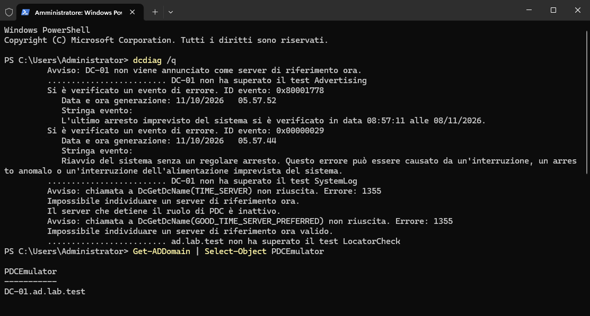
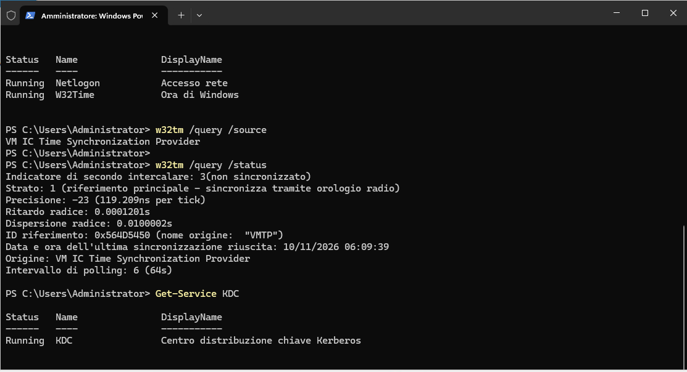
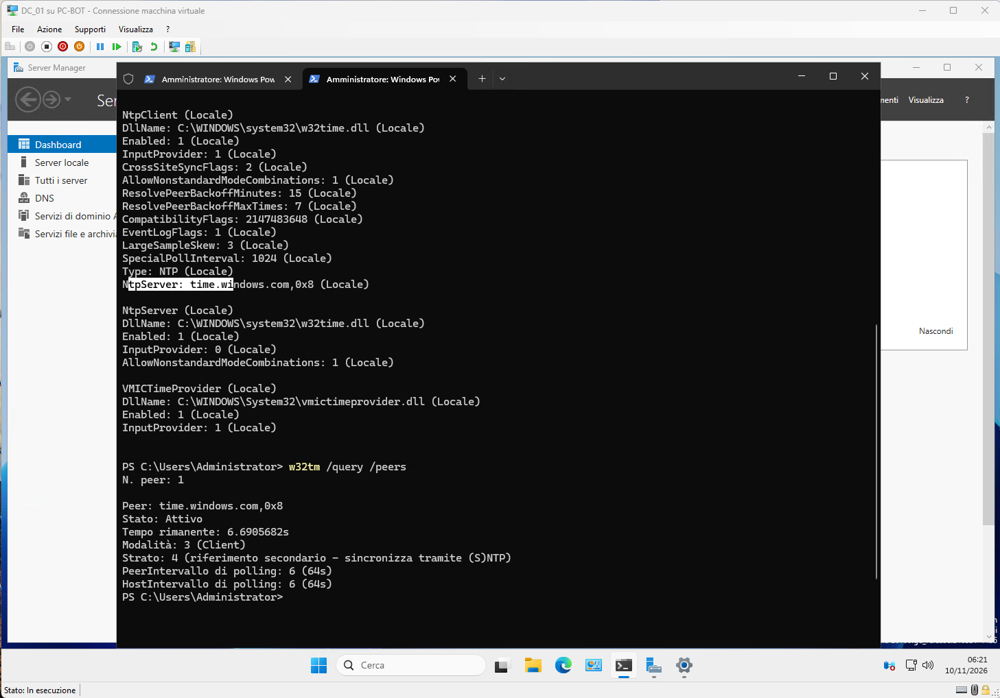
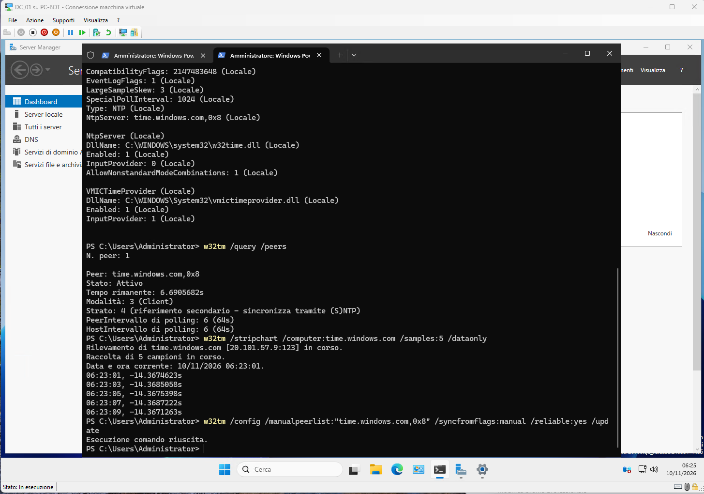
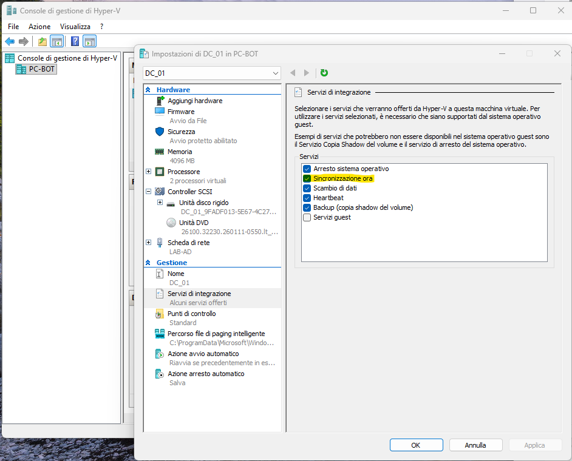
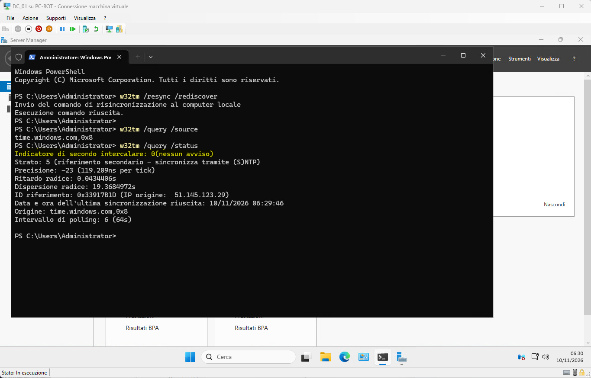
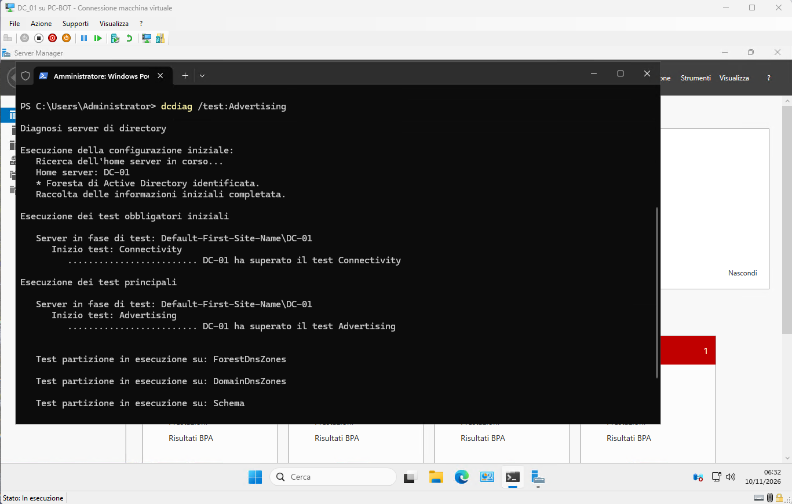

# AD-001 — Domain Controller Time Synchronization Troubleshooting

**Environment:** Windows Server on Hyper-V · `DC-01` · Active Directory domain `ad.lab.test`  
**Date of captured investigation:** 10 November 2026  
**Status:** Time source corrected and `Advertising` test passed; additional health checks remain to be documented.

## 1. Problem

While validating a newly configured domain controller, `dcdiag /q` reported several warnings and failures, including:

- The DC was not successfully advertising itself (`Advertising`).
- The `LocatorCheck` test could not identify a valid time server (`DcGetDcName` error `1355`).
- System event-log findings included unexpected shutdown events. These were recorded as separate observations, **not assumed to be caused by the time-sync configuration**.

The DC was also identified as the **PDC Emulator** for the lab domain.

```powershell
dcdiag /q
Get-ADDomain | Select-Object PDCEmulator
```



## 2. Initial diagnostics

The **Netlogon**, **W32Time** and **KDC** services were observed in the `Running` state. Therefore, the immediate investigation moved to the configuration and current source of the Windows Time Service.

```powershell
Get-Service Netlogon,W32Time,KDC
w32tm /query /source
w32tm /query /status
w32tm /query /configuration
w32tm /query /peers
```

The initial source was:

```text
VM IC Time Synchronization Provider
```

The captured status also displayed **Leap Indicator 3 (not synchronized)**. The NTP client configuration already mentioned `time.windows.com,0x8`, but this was **not the source selected at that point**.



The configuration showed that the VM integration time provider was enabled, and `time.windows.com,0x8` was listed as an active peer.



To check the relative time difference with the external server, I ran:

```powershell
w32tm /stripchart /computer:time.windows.com /samples:5 /dataonly
```

The five captured samples were approximately **−14.36 seconds**. This confirmed a measurable difference against the remote time source during the test; it does not by itself establish the root cause of the DC diagnostic failures.

## 3. Configuration and correction

On the lab's PDC Emulator, I explicitly configured manual NTP synchronization and marked the DC as a reliable time source for the domain:

```powershell
w32tm /config /manualpeerlist:"time.windows.com,0x8" /syncfromflags:manual /reliable:yes /update
```

The command returned a successful completion message.



I also inspected the **Hyper-V → VM Settings → Integration Services → Time Synchronization** option. The screenshot shows this option **enabled** at the time of inspection. It does **not** demonstrate that the integration service was disabled or that disabling it was part of the fix.



Finally, I requested a resynchronization and rediscovery of the configured source:

```powershell
w32tm /resync /rediscover
```

## 4. Verification

The resynchronization command completed successfully. Subsequent checks showed:

- `w32tm /query /source` → **`time.windows.com,0x8`**
- `w32tm /query /status` → **Leap Indicator 0 (no warning)**
- The time service reported a successful recent synchronization via the configured NTP source.

```powershell
w32tm /query /source
w32tm /query /status
```



I then re-ran the domain-controller advertising test:

```powershell
dcdiag /test:Advertising
```

The captured output confirms that **`DC-01` passed the `Connectivity` and `Advertising` tests**.



## 5. Result and limitations

**Verified outcome:** The DC switched from the Hyper-V time integration provider to the manually configured NTP source, the time status no longer showed a synchronization warning, and the `Advertising` test passed.

**Not established by the available screenshots:** The final result of `LocatorCheck`, the complete result of a subsequent `dcdiag /q`, and long-term synchronization stability. These should not be described as verified.

Recommended follow-up commands for a future lab session:

```powershell
dcdiag /q
dcdiag /test:LocatorCheck
w32tm /query /source
w32tm /query /status
```

Any remaining SystemLog warnings should be investigated independently instead of being attributed automatically to NTP.

## 6. What I learned

- A configured NTP peer is not necessarily the **currently selected** time source.
- Time synchronization in a domain deserves special attention on the **PDC Emulator**.
- Hyper-V time integration is another component to inspect in a virtualized DC.
- Diagnostics should be repeated after changes, and only captured successful results should be reported as passed.

---

*Personal, non-production laboratory. Screenshots and commands document an actual troubleshooting session; this write-up is not a universal remediation procedure for every Active Directory deployment.*
